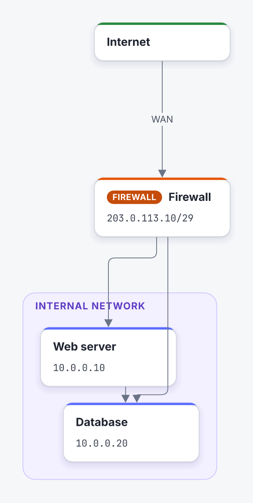
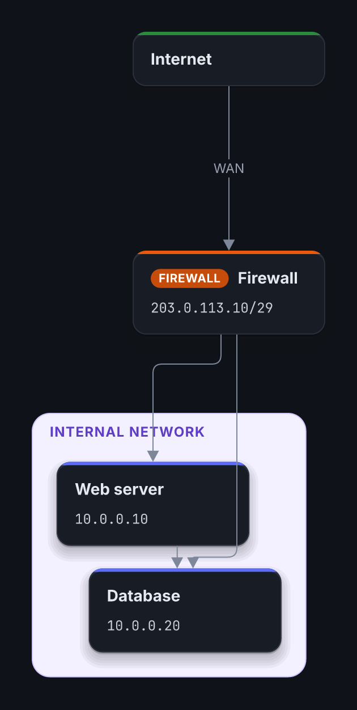

# skemo — the `skemo` command-line tool

**Draw diagrams as text, get a polished image.** `skemo` turns a readable text file (`.skemo`) into an
architecture, network or process diagram, a timeline or a planning chart, as **PNG, SVG, WebP, HTML animated step by
step, GIF or animated PNG**.

It is a single executable with no dependencies: no Node, no browser, no Graphviz. Fonts and the default theme are
embedded, and the output is **identical from one machine to the next**.

| The text | The result |
|---|---|
| <pre>diagram(dir="down")<br><br>  card#internet.cloud Internet<br>    to(fw) WAN<br><br>  card#fw.firewall Firewall<br>    &#124; 203.0.113.10/29<br>    to(web)<br>    to(base)<br><br>  zone#internal.internal Internal network<br>    card#web.server Web server<br>      &#124; 10.0.0.10<br>      to(base)<br>    card#base.server Database<br>      &#124; 10.0.0.20</pre> |  |

## Why skemo?

- **Text is the source**: a diagram is read, diffed (`git diff`) and fixed like code.
- **Automatic layout, hand-tuned where you want**: cards place themselves; you pin only what you care about
  (`at="x,y"`) and force a side or a waypoint on an arrow (`side`, `via`).
- **Styling is CSS**: one card type = one line of CSS (colour, label). Light, dark and print themes (readable in
  black and white), with a built-in contrast check.
- **Step-by-step animation**: `@1`, `@2:up`, `@3-5:focus`… to unfold a diagram in a presentation (HTML, GIF,
  animated PNG or animated WebP).
- **Stable**: changing one card only moves the arrows attached to it.

## Installation

The project is a pre-release (`0.1.0-rc.3`). Release binaries (Linux x86_64 and ARM, macOS ARM, Windows, with
SHA-256 checksums) are on the repository's [releases page](https://github.com/skemonet/skemo/releases).

**From source** (recent Rust, edition 2024, i.e. 1.85 or later; [rustup.rs](https://rustup.rs)):

```bash
git clone https://github.com/skemonet/skemo skemo && cd skemo
cargo build --release -p skemo-cli
./target/release/skemo --version        # the binary: target/release/skemo (about 20 MB)
```

Static Linux binary (musl): `sudo apt install musl-tools && rustup target add x86_64-unknown-linux-musl`, then
`cargo build --release -p skemo-cli --target x86_64-unknown-linux-musl`.

## Quick install (release binary)

```bash
curl -fsSL https://raw.githubusercontent.com/skemonet/skemo/main/cli/install.sh | sh
```

Installs the latest release into `~/.local/bin` after checking its SHA-256 (`SKEMO_VERSION`, `SKEMO_BIN`). Linux (x86_64, ARM) and macOS (ARM); on Windows, take `skemo-windows-x86_64.exe` from the releases page. A release is one binary per platform, its SHA-256 in the release's description; `skemo licences` prints the licences of what it embeds (fonts, icons, Rust crates).

## Getting started

```bash
skemo init my-diagram            # creates example.skemo and a commented custom.css, overwriting nothing
cd my-diagram
skemo example.skemo --css custom.css          # writes example.png (render is the default command)
skemo watch example.skemo --css custom.css      # live preview in the browser, reloaded on every save
```

### The format in 30 seconds

A `.skemo` file is **Pug** restricted to seven tags, with content lines written `| text`:

| Tag | Role |
|---|---|
| `card#id.type Title` | a card; its `\|` lines are content lines (Markdown emphasis; a line ending in `\|` is a table row) |
| `cards#id.type Title` | a card drawn as a pile of several instances; `count="N"` adds a `×N` badge |
| `zone#id.type Title` | a group containing cards or other zones (by indentation); its `\|` lines are description lines |
| `stack` | an invisible group that lays its children one after the other |
| `to(target).type Label` | an arrow, written inside its source card |
| `title Text` | the diagram's title, under `diagram`; its `\|` lines are subtitle lines |
| `diagram(dir="down")` | global options (direction, theme, `timeline`, `frieze` or `mindmap` layout) |

Useful attributes: `at="x,y"` (pinned position), `side="bottom-top"` (attachment sides), `via="x,y"` (waypoint),
`tag="Owner"` (badge), `join="trunk"` (several targets sharing one trunk). The `.type` classes are CSS classes: see the `custom.css` created by `skemo init`, and
`skemo theme --print` for the default theme. The **full specification** is
[`FORMAT.md`](../lang/FORMAT.md) in the `lang` folder; the user
documentation is the site built from `lang/site/` (docs.skemo.net).

## For AI agents: the skemo skill

[`skill/skemo/`](skill/skemo/SKILL.md) is a public agent skill (the `SKILL.md` format of Claude Code and other
agents): it teaches an agent to write `.skemo` files, check them and render them, instead of drawing SVG by hand,
which costs about 17 times more output tokens. Install it by copying the folder into `~/.claude/skills/` (or
`.claude/skills/` in a project). `tests/skill.rs` renders every example of the skill, so it cannot drift from the
binary.

## Commands

| Command | Role |
|---|---|
| `skemo f.skemo` (= `skemo render f.skemo`) | **default command**: writes `f.png` next to the source. `-o out.{png,svg,html,gif,apng,webp}` picks another file and format (the extension decides; `.webp` is lossless: animated if the diagram has steps, still otherwise); `--format svg` changes the default extension |
| `skemo check f.skemo…` | diagnostics (exit code 1 on errors); `--contrast` checks text legibility |
| `skemo fmt f.skemo… [--check]` | canonical formatting (indentation, attribute order) |
| `skemo watch f.skemo` | live preview on `127.0.0.1:8710` |
| `skemo layout f.skemo --json` | full layout (positions and routes) as JSON |
| `skemo theme --print` | writes the default theme, a starting point for a custom one |
| `skemo init [folder]` | creates a sample diagram and a commented CSS file |

`render` options: `--css custom.css` (repeatable), `--theme light|dark|print|auto`, `--scale 2`,
`--transparent` (SVG, PNG, APNG without background), `--contrast high` (darkens texts below the WCAG threshold),
`--step 2.5` (one animation state), `--animated` (one PNG per step), `--board` (contact sheet of the steps),
`--base-theme theme.css`, `--deny-warnings`. Details: `skemo render --help`.

Exit codes: **0** OK · **1** errors in the file · **2** wrong usage · **3** internal error.

**Language**: help, diagnostics and messages follow your system language (`LANG`, `LC_ALL`… as usual; English and French so far). `--lang en|fr` or `SKEMO_LANG=fr` overrides it. Month and century labels drawn in timelines and friezes follow it too, unless the diagram pins them with `diagram(lang="en")`.



## Performance

2 ms start-up; rendering the examples: HTML 16 to 25 ms, PNG 47 to 155 ms (Linux x86_64, release binary).
`watch` polls files every 300 ms and only serves on `127.0.0.1`.

## Development

```bash
../tools/ci.sh         # quality + security of the whole repository: the same pipeline as the CI
cargo test --release -p skemo-cli
```

This crate is deliberately thin: all the logic lives in [`skemo-engine`](../engine) (rendering) and
[`skemo-lang`](../lang) (language). Requirements: `SPEC.md`. Project overview: the [root README](../README.md).

## License

MIT OR Apache-2.0, at your option (`LICENSE-MIT` and `LICENSE-APACHE` at the root of the repository). The
embedded fonts (Inter, JetBrains Mono) are under the SIL OFL 1.1.

