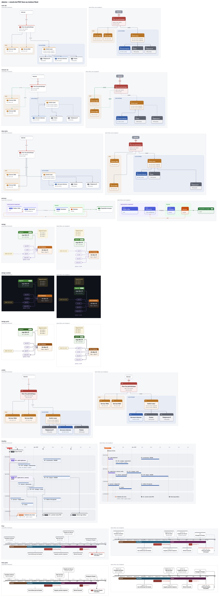

# skemo-engine — the skemo rendering engine

Rust library that turns a [skemo](https://github.com/skemonet/skemo) diagram into an image: it **measures** the
text, **lays out** the cards automatically, **routes** the arrows and **draws** the result as HTML, SVG, PNG, WebP,
GIF or animated PNG, with animation steps. The same code runs **natively** (it is what the
[`skemo`](https://github.com/skemonet/skemo/tree/main/cli) command-line tool uses) and **in the browser** as WebAssembly.



## The pipeline

```text
.skemo text ──▶ model ──▶ CSS styles ──▶ measure ──▶ layout ──▶ routing ──▶ rendering
             (skemo-lang) (skemo-lang)  (embedded   (ELK, elk-rs) (skemo-router)  HTML / SVG / PNG
                                         fonts)                                  GIF / APNG / WebP
```

- **No browser**: text is measured with embedded fonts (Inter, JetBrains Mono) and `harfrust`; it matches, to the
  pixel, the sizes Chromium measured on the 117 reference cards.
- **Layout** by ELK (the Rust port `elk-rs`), or by dates in `timeline` and `frieze` modes.
- **Routing** by [`skemo-router`](https://github.com/skemonet/skemo/tree/main/router): every arrow, with automatic or
  pinned positions.
- **Deterministic**: same inputs, same bytes, natively and in WebAssembly (tested).
- **Stable**: positions do not depend on editing history, and cards can be pinned (`at=`) without the rest
  moving.

## Library usage

```toml
# Cargo.toml: not yet published on crates.io
skemo-engine = { git = "https://github.com/skemonet/skemo" }
```

```rust
use skemo_engine::{Options, from_source, html, png, svg};

let source = "card#a Start\n  to(b) next\ncard#b End\n";
let options = Options {
    css: vec![".t1 { --c: #E8590C; }".to_string()],   // custom CSS, applied after the theme
    theme: Some(skemo_lang::style::Theme::Dark),
    ..Options::default()                              // + base_theme, high_contrast, transparent
};
let (diagram, warnings) = from_source(source, &options).unwrap();

let svg = svg::render(&diagram);                                    // standalone SVG
let page = html::render(&diagram, &html::HtmlOptions::default());   // standalone HTML, animated by steps
let image = png::render(&diagram, 2.0).unwrap();                    // PNG at scale 2 (also `webp::render`, `webp::animated`)
let layout = diagram.layout_json();                                 // positions and routes as JSON
assert!(svg.contains("<svg") && page.contains("<card") && image.starts_with(b"\x89PNG"));
assert!(warnings.is_empty());
```

File errors come back as diagnostics (`Error::Source`), ready to display. `Session` provides interactive
drag-and-drop: moving a card re-routes the arrows and yields exactly the drawing you would get by reloading the
edited file.

## In WebAssembly

```js
import init, { render } from './engine_wasm.js';
await init();
const r = JSON.parse(render(source, css, JSON.stringify({ theme: 'dark' })));
// r.html, r.svg, r.layout, r.diagnostics, r.warnings
```

And a **ready-made HTML tag** that displays a diagram (or a timeline) in any page:

```html
<script type="module" src="skemo-view.js"></script>
<skemo-view src="schema.skemo" css="perso.css" step="2" theme="dark"></skemo-view>
```

Build the demo (`wasm32-unknown-unknown` and `wasm-bindgen-cli` 0.2.129):

```bash
rustup target add wasm32-unknown-unknown && cargo install wasm-bindgen-cli --version 0.2.129 --locked
tools/wasm-demo.sh
cd crates/engine-wasm/demo && python3 -m http.server 8000     # index.html, element.html, drag.html
```

The WebAssembly weighs about 3.6 MB compressed (fonts included).

## Layout of the repository

| Path | Contents |
|---|---|
| `crates/engine` | the library (`skemo-engine`): `diagram`, `scene`, `measure`, `layout`, `route`, `svg/`, `html`, `png`, `animated`, `anim`, `contrast`, `session`, `timeline`, `frise`… |
| `crates/engine-wasm` | the WebAssembly API and the `<skemo-view>` tag (`demo/`) |
| `fixtures/` | the **oracle**: reference diagrams and results from the JavaScript prototype |
| `tools/` | native / WASM parity, demo, contact sheets |

## Development

```bash
../tools/ci.sh         # quality + security of the whole repository (see CONTRIBUTING.md)
cargo test --release   # oracle (measure, layout), reference outputs, animation, contrast, stability
tools/wasm-parity.sh   # the same layout.json natively and in WebAssembly
```

`tests/golden.rs` compares a fingerprint of the outputs (SVG in the three themes, HTML, PNG) of every example
with `tests/golden.txt`: a refactoring must change nothing; after an intended change,
`UPDATE_GOLDEN=1 cargo test --release --test golden`, then review the diff.

Requirements: `SPEC.md`. Depends on: [`skemo-lang`](https://github.com/skemonet/skemo/tree/main/lang),
[`skemo-router`](https://github.com/skemonet/skemo/tree/main/router), `elk-rs` (EPL-2.0). License: MIT OR Apache-2.0
(`LICENSE-MIT` and `LICENSE-APACHE` at the root of the repository); the embedded fonts are under the SIL OFL 1.1; the built-in icons are
[Lucide](https://lucide.dev) (ISC, `crates/engine/assets/icons/LICENSE-lucide.txt`; regenerate with
`tools/gen-icons.py`); the `elk-rs` notice (EPL-2.0) accompanies distributions.
