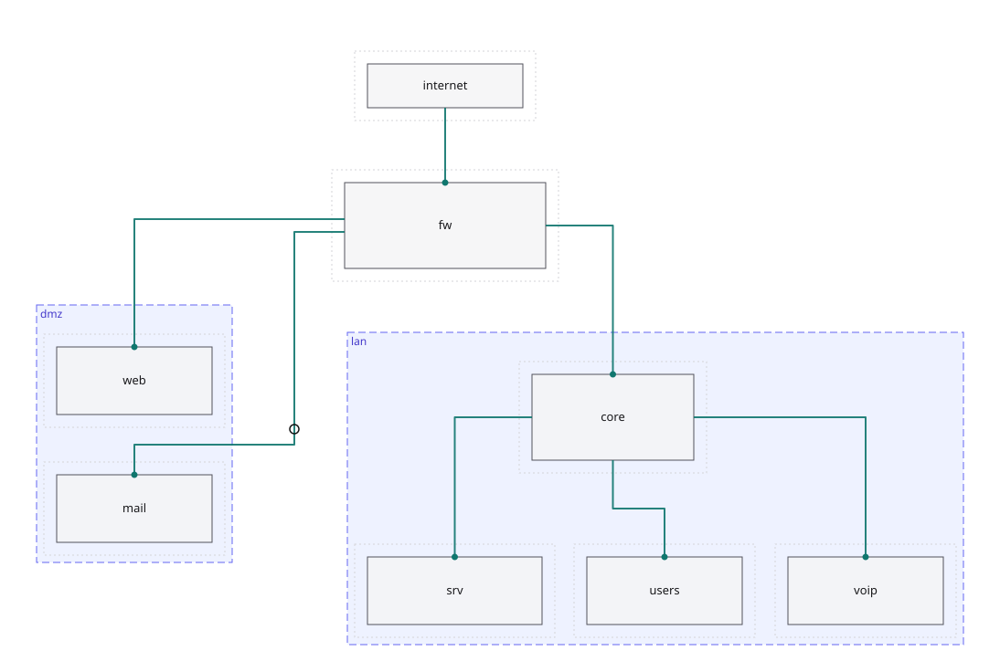

# skemo-router — orthogonal connector router

A **generic** Rust library: give it fixed rectangles (shapes), optionally regions, and connectors; it computes
**right-angle routes** that go around obstacles, with few bends and well-spaced parallel segments. It draws the
arrows of [skemo](https://github.com/skemonet/skemo), but it knows neither that format nor CSS: you can use it on
its own, for instance in any diagram editor.



*Routes computed by the router: shapes are the grey boxes, dotted lines show their margin, dashed boxes are regions, the hollow circle is a waypoint.*

## What it does

- Goes around shapes with an adjustable **margin**; a path stays possible when a corridor is narrower than two
  margins.
- **Forced attachment sides** (`Side`), **waypoints** (in order), **free endpoints** (dragging an arrow into the
  void), **traversable regions** (some connectors may cross them, others may not).
- **Spreads attachment points** along a side, **spaces** parallel segments, removes small jogs.
- **Deterministic** (same inputs, same routes), **panic-free** on degenerate inputs (tested on random scenes),
  **WebAssembly**-compatible, no dependencies.
- **Incremental** API (`Router::update`) for interactive editing.

Method: sparse orthogonal visibility graph and A* search with a bend penalty, after Wybrow, Marriott and
Stuckey, *Orthogonal Connector Routing* (GD 2009), and `hightower` (MIT/Apache). The origin of the ideas is
recorded in `PROVENANCE.md`.

## Usage

```toml
# Cargo.toml: not yet published on crates.io
skemo-router = { git = "https://github.com/skemonet/skemo" }
```

```rust
use skemo_router::{route, Connector, End, Obstacle, Params, Rect};

let obstacles = [
    Obstacle::shape("a", Rect::new(0.0, 0.0, 100.0, 50.0)),
    Obstacle::shape("b", Rect::new(300.0, 200.0, 100.0, 50.0)),
    Obstacle::shape("wall", Rect::new(150.0, -100.0, 40.0, 400.0)),
];
let c = Connector::new("a->b", End::shape("a"), End::shape("b"));
let (routes, diagnostics) = route(&obstacles, &[c], &Params::default());
assert!(diagnostics.is_empty());
// the wall forces the route underneath: it leaves "a" through the bottom
assert_eq!(routes[0].points, vec![(50.0, 50.0), (50.0, 314.0), (350.0, 314.0), (350.0, 250.0)]);
```

Invalid input (non-finite rectangle, duplicate id, unknown endpoint) never panics: it is reported in
`diagnostics`. Settings live in `Params` (margin, segment spacing, bend cost…).

## Performance

50 shapes / 100 connectors in 13 ms; 500 / 1,000 in 0.45 s. `cargo run --release --example scale` prints a
**fingerprint** of the routes: it must not change when optimising.

## Try it

```bash
cargo run --example review -- fixtures/manuel-via.json > /tmp/review.svg   # visual review of a test case
cargo build --target wasm32-unknown-unknown --release                       # WebAssembly
demo/wasm/build.sh --serve                                                  # demo: drag shapes, http://localhost:8765/
```

## Development

```bash
../tools/ci.sh         # quality + security of the whole repository (see CONTRIBUTING.md)
```

Requirements: `SPEC.md`. **Provenance rule**: the code of libavoid and its ports (LGPL) is never read or
translated; we work from the papers. This repository depends on no other project repository.
License: MIT OR Apache-2.0 (`LICENSE-MIT` and `LICENSE-APACHE` at the root of the repository).
